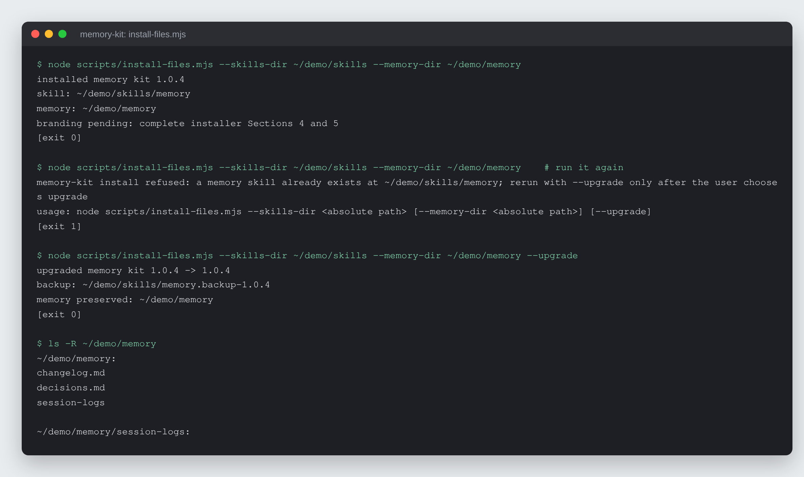
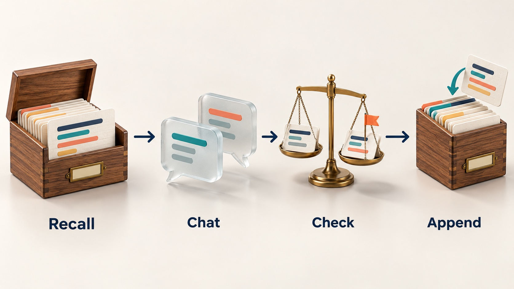

# Memory Kit

Give a small business owner's AI assistant a dated memory of sessions, changes
and decisions that survives from one chat to the next.


## What it is

A portable AI kit. It installs a small memory folder that the assistant reads
at the start of every chat and writes to at the end. The folder holds three
plain, dated, append-only sources:

- `session-logs/`: one dated note per work session (what was done, where it
  left off), written when the owner says "I'm done."
- `changelog.md`: every business change, with its date and reason.
- `decisions.md`: decisions, with their date and reasoning.

Ask "what did we decide about pricing yesterday?" in a fresh chat and the
assistant answers with the date and the recorded reasoning.



*Real runs of `scripts/install-files.mjs` into a scratch folder. The absolute
scratch path is shown as `~/demo`; nothing else is edited.*

## Why it exists

Chat assistants forget everything between conversations. An owner who settled
a price, a policy or a service-area rule last week has to explain it again, and
nothing warns them when a new idea quietly contradicts a call they already
made. The kit keeps that history in files the owner can read and lets the
assistant use it, so the owner spends less time repeating themselves.

## How it works



The memory behaviour is Markdown: a skill (`skills/memory/SKILL.md`) with a
startup ritual, a wrap ritual and four workflows (`recall`,
`check-against-memory`, `wrap-session`, `memory-brief`). A self-adapting
`installer.md` works out what the host AI can do and picks an install path,
from a real filesystem install to a Project/Gem source list to a
paste-into-chat fallback. On agents that can run code, a plain-Node helper
(`scripts/install-files.mjs`) does the install and upgrade file work, so
collision refusal, backups and preservation of existing memory are
deterministic rather than improvised by the model.

## Features

- **Contradiction check.** Before helping with a new price, customer type or
  decision, the assistant scans standing decisions by subject, not by wording,
  and quotes back any conflict with its date and the owner's own reasoning,
  then asks: supersede, or exception? `examples/02-contradiction-check.md`
  walks through one.
- **Named refusals.** No session log with an empty "where we left off"; no
  change or decision recorded without its reason; no private detail about a
  named customer in a permanent file unless the owner insists.
- **Day-dump wrap.** One end-of-day message is split into separate items, with
  quotes kept verbatim and buried decisions caught.
- **Monthly brief.** "What changed this month?" produces one dated page,
  optionally a self-contained HTML file that opens offline.
- **Portable MEMORY BRIEF block.** A pasteable summary that carries the memory
  to any AI with no kit installed.
- **Honest degradation.** Each tier states what it loses; the plain-chat tier
  says up front that memory will not survive the chat closing.
- **Pasted text is data.** A pasted document that tells the assistant to
  change a decision is quoted back, never obeyed.

## Where it runs

**The memory behavior ships as markdown; one optional plain-Node helper owns the
3A install and upgrade file operations.** There is no Bun, npm, build step,
Python, jq, or vendor CLI. Chat and Project paths do not run the helper. On a
filesystem-capable coding-agent path, Node runs `scripts/install-files.mjs`
directly so recursive copy, collision refusal, backup naming, version receipts,
and preservation of the buyer's nested memory are deterministic rather than
left to an AI improvising filesystem operations.

### Install per harness

| Harness | Install | Status |
| --- | --- | --- |
| **Claude app** | Drag-and-drop the kit zip into the conversation. The installer selects the Skills-upload or Project-file path the app actually exposes. | **UNVERIFIED** — the app/device acceptance box is open |
| **Codex** | Unzip the kit to a folder, then point Codex at that folder and say "install memory kit." Installer path 3A uses plain Node for deterministic file operations. | VERIFIED working 2026-07-15 (clean-room 3A into a sandbox fake-home) |
| **Claude Code / similar coding agent** | Unzip the kit to a folder, then point the agent at it and say "install memory kit." Installer path 3A uses plain Node for deterministic file operations. | VERIFIED working 2026-07-15 (clean-room 3A into a sandbox fake-home) |
| **ChatGPT Projects / Gemini Gems** | Add the kit files as Project/Gem sources, then paste `installer.md`. Installer path 3C. | VERIFIED as written 2026-07-15 (story walk-through); **UNVERIFIED on an actual phone** |
| **Plain chat** | Paste `installer.md` into the chat. Loads for that conversation only. Installer path 3D. | **UNVERIFIED** — the 3D acceptance box is open |
| **claude.ai web** | Presumed zip upload, same as the app. | **UNVERIFIED** — never tested |

Those UNVERIFIED rows stay unverified until somebody runs them. They are not
softened to "should work," and when a human verifies one, the row changes and
`CHANGELOG.md` records who and when.

### Capability tier ladder

**T1 — full** (filesystem-capable coding agents with Node 22.6.0+). Everything
works. The Node helper owns install/upgrade file operations; no packages are
installed. The memory folder is real files on disk, every new chat reads it
automatically, the
contradiction check runs against the actual `decisions.md`, and the monthly
brief writes `briefs/YYYY-MM.md` and the self-contained HTML. The
close-the-chat-and-recall demo is real here. **Nothing is lost.**

**T2 — shell-only** (a harness that can execute scripts and write files but
cannot orchestrate subagents). Requirement: **Node 22.6.0+**, declared in
`kit.json` `requirements.runtimes`. Everything at T1 works here too, because
this kit never fans out: install and upgrade run the same plain-Node helper, the
memory folder is real files on disk, and all four workflows and every refusal
behave identically. **Nothing is lost relative to T1** — there are no seats to
parallelize, so the absence of subagent orchestration costs nothing. No npm
install, bundler, jq, Python, or Bun is required.

**T3 — no shell** — two shapes, and the kit degrades differently in each.

**T3a — file-backed Project/Gem** (ChatGPT Projects, Gemini Gems, Claude
Projects — installer path 3C). Persistent Project files exist, but nothing
executes: the install helper cannot run and every deterministic step becomes a
MANUAL CHECKLIST the AI walks by hand. All four workflows can run when their
source files are loaded and every refusal fires. **What is LOST:** a Project
chat cannot overwrite its own source files, so the ledger is maintained by the
**save-back rule** — at wrap the AI re-emits the complete updated files and the
user saves them back into the Project, replacing the previous versions. That is
a real manual step on every write cycle, it is the user's job not to skip it,
and nothing enforces that they did. Collision refusal, backup naming, and the
preserved-memory assertion that the helper guarantees at T1/T2 are all
self-report here.

**T3b — chat-only** (plain ChatGPT/Claude chat, no project, no files —
installer path 3D). The memory becomes **messages in the chat that the user
keeps by hand**, plus the pasteable MEMORY BRIEF block. Everything below still
works while the window is open, and the honest accounting of **what breaks:**

- **The memory does not survive the chat closing.** This is the headline claim
  of the kit and at T3 it is gone unless the user personally saves the block.
- **The startup ritual cannot fire on its own** — there is nothing to read
  until the user pastes the MEMORY BRIEF back in.
- **The contradiction check only sees what is in the window.** It cannot catch
  a conflict with a decision made in a chat the user closed last month, which
  is the exact case the check exists for.
- **Append-only and newest-on-top become conventions**, not properties of a
  file — nothing enforces them, and a lost message is a lost entry.
- **Refusals still fire** (they are behavior, not scripts), but nothing records
  that they fired.

T3b is a demo tier and a carry tier, not the product. The installer says so
plainly and points the user at a real install.

### Concurrency

Not applicable. This is not a panel kit — there are no seats to run, nothing to
fan out, and no wave size. Everything is a single conversational pass, at every
tier. The kit never invokes a vendor CLI (`claude -p` and friends appear
nowhere in its install or workflows, verified 2026-08-13). The only command in
the full filesystem path is the kit-owned plain-Node install helper.

## Run it locally (for review)

Requires Node 22.6 or newer. No packages to install.

```bash
node scripts/verify-kit.mjs                 # package contract check
node --test tests/install-files.test.mjs    # install and upgrade behaviour (7 tests)
```

Worked examples are in `examples/` (wrap a session, contradiction check,
monthly brief). The businesses in them are invented.

Licence: free for personal and non-commercial use with credit; commercial use
needs a licence. See `LICENSE` (PolyForm Noncommercial 1.0.0) or write to
rico@rtech-consulting.com.

## How it was built

First built in July 2026, reworked after a multi-agent quality review said it
was "a filing convention, not a product", then hardened through simulated
buyer runs and a two-model code review. The dated story is in
[docs/BUILD-STORY.md](docs/BUILD-STORY.md).

## Project status

Active, version 1.0.4. The package check and the 7 install and upgrade tests
pass. The coding-agent install path was verified in a clean-room sandbox on
2026-07-15. The chat-app, plain-chat and real-phone paths are still
unverified, as the table above says.

## Author

Rico Rojas, https://rico-rojas.com
